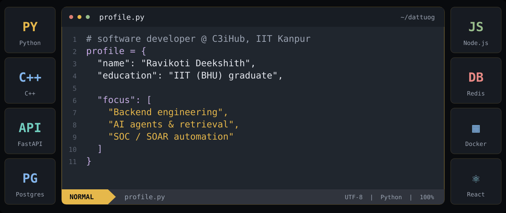

<!-- Original graphics and layout inspired by Sh4den's GitHub profile. -->

  <picture>
    <source media="(max-width: 600px)" srcset="assets/welcome-mobile.svg" />
    
  </picture>
    
  <picture>
    <source media="(prefers-reduced-motion: reduce) and (max-width: 600px)" srcset="assets/profile-mobile.svg" />
    <source media="(prefers-reduced-motion: reduce)" srcset="assets/profile.svg" />
    <source media="(max-width: 600px)" srcset="assets/profile-mobile.gif" />
    
  </picture>
    
  
  &nbsp;
  
  &nbsp;
  

 

I build backend services, AI agents, and security automation. Previously: <b>Seekvens.ai</b> &amp; <b>Edvenswa Tech</b>.

 

<h2 align="center">Selected Projects</h2>

<table width="100%">
  <tr>
    <td align="center" width="50%" valign="top">
      
      <h3><a href="https://github.com/Dattuog/Personal-AI-Memory-Agent">PAMA</a></h3>
      
Personal AI memory with semantic retrieval, recency ranking, reminders, and multi-step queries.

      
Python · FastAPI · ChromaDB · Docker

      
<a href="https://github.com/Dattuog/Personal-AI-Memory-Agent"><b>View repository ↗</b></a>

    </td>
    <td align="center" width="50%" valign="top">
      
      <h3><a href="https://github.com/Dattuog/personal-finance">FinPilot AI</a></h3>
      
A personal-finance app with deterministic analytics and optional AI explanations. In development.

      
Next.js · TypeScript · PostgreSQL · Prisma

      
<a href="https://github.com/Dattuog/personal-finance"><b>View repository ↗</b></a>

    </td>
  </tr>
  <tr>
    <td align="center" width="50%" valign="top">
      
      <h3><a href="https://github.com/Dattuog/eterna_labs_assignment">Axiom Pulse</a></h3>
      
A token-discovery interface with simulated live prices, sorting, and rich interactions.

      
Next.js · TypeScript · Redux · React Query

      
<a href="https://github.com/Dattuog/eterna_labs_assignment"><b>View repository ↗</b></a>

    </td>
    <td align="center" width="50%" valign="top">
      
      <h3><a href="https://ravikoti-deekshith.vercel.app/">Developer Portfolio</a></h3>
      
My work, projects, and background, collected in one place.

      
React · Web development

      
<a href="https://ravikoti-deekshith.vercel.app/"><b>Visit portfolio ↗</b></a>

    </td>
  </tr>
</table>

 

